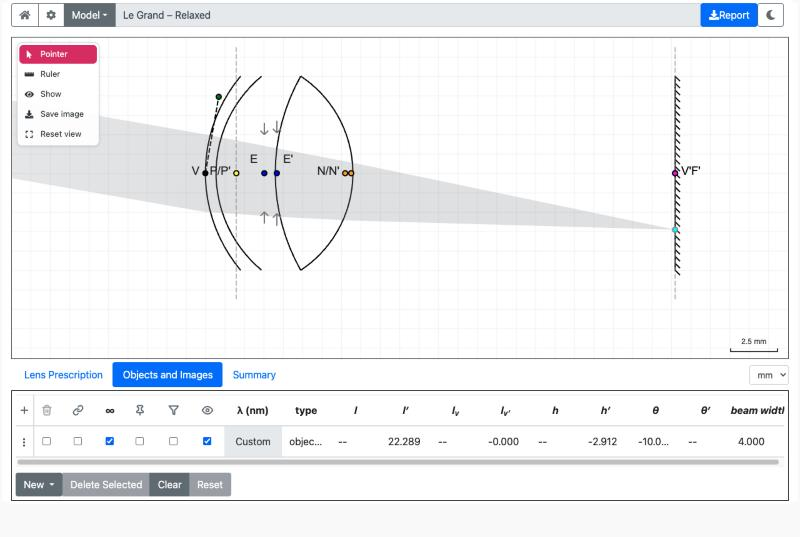
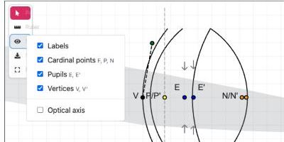
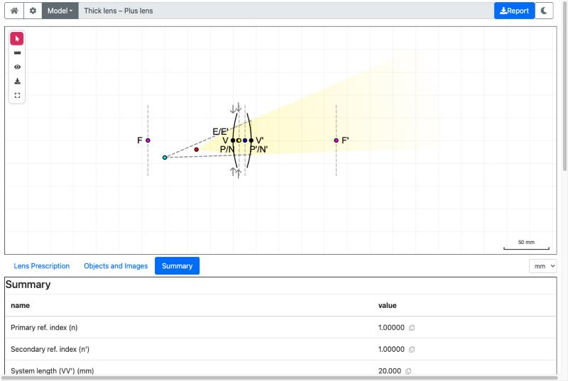
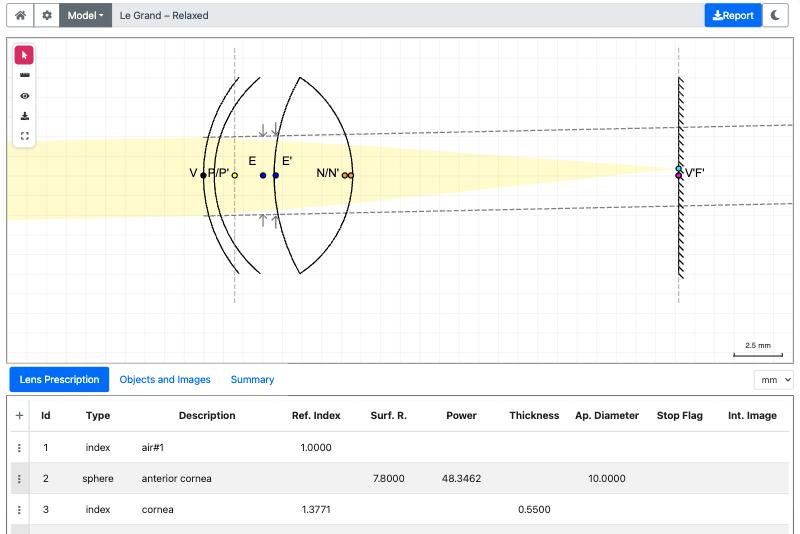
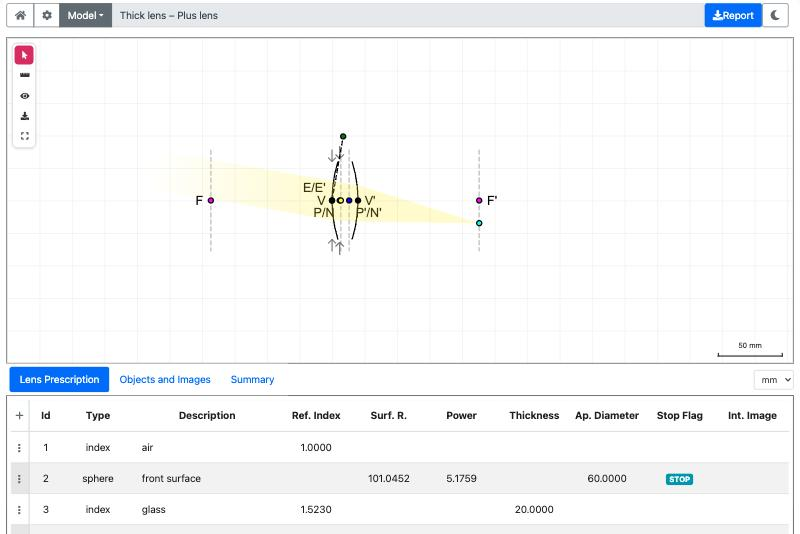
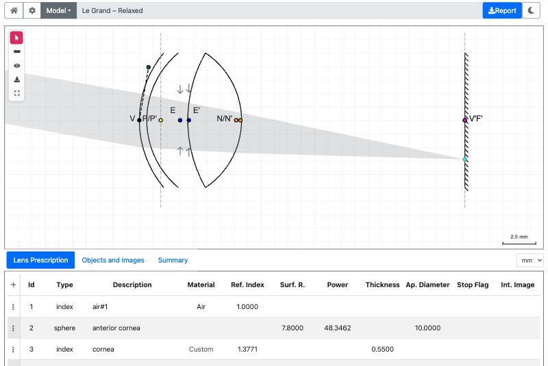
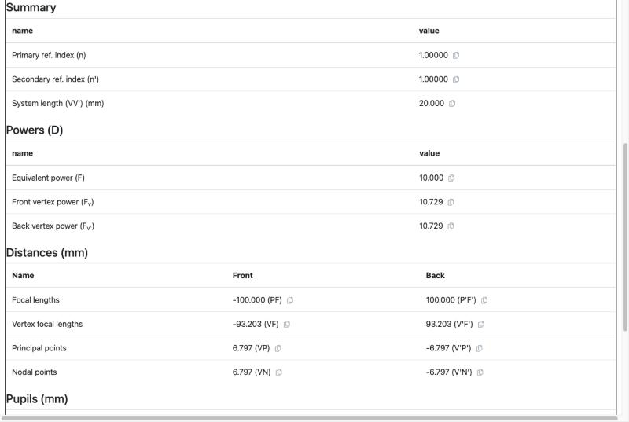
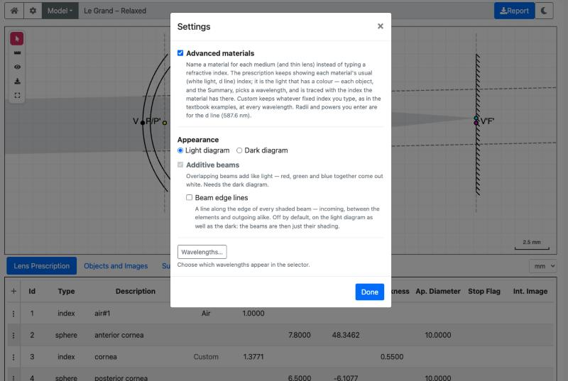
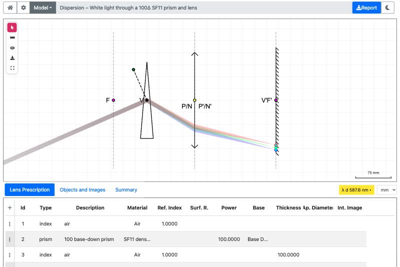
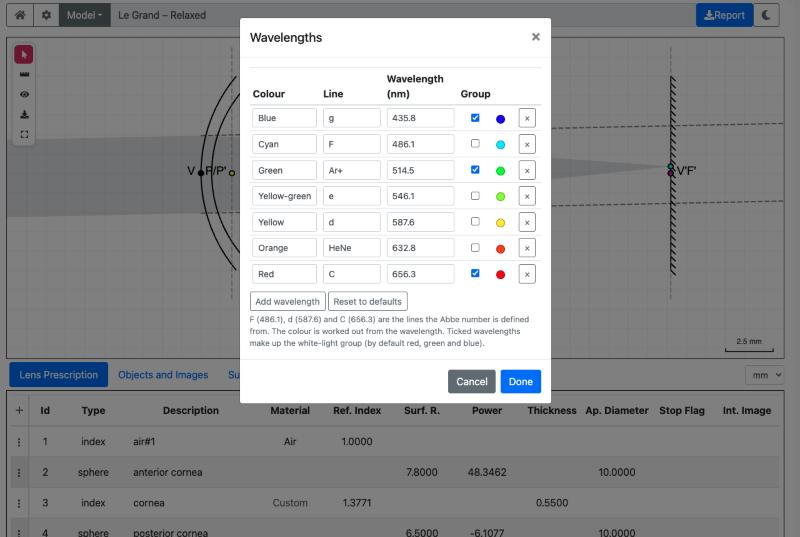

# SOVS optics bench: user guide

An interactive paraxial ray-tracer for the OPTOM 263 Essential Optics course (School of Optometry and Vision Science,
University of Auckland). You build or load an optical system (a lens, a telescope, a schematic eye, an instrument),
place objects in front of it, and see where the images form, drag things about, and read the numbers.

It uses paraxial (small-angle) optics and the sign conventions used in optometry. It is a teaching tool: the rays are
exact for the paraxial model and say nothing about aberrations.

<h2 id="contents">Contents</h2>

* [1. What it does](#what-it-does)
* [2. Opening it](#opening-it)
* [3. The screen](#the-screen)
* [4. Objects and images](#objects-and-images)
  * [4.1 What the columns mean](#what-the-columns-mean)
  * [4.2 Real, virtual and the colours](#real-virtual-and-the-colours)
* [5. Moving things on the diagram](#moving-things-on-the-diagram)
  * [5.1 Snapping to the cardinal points](#snapping-to-the-cardinal-points)
  * [5.2 Grid](#grid)
* [6. Reading the diagram](#reading-the-diagram)
* [7. The tables](#the-tables)
  * [7.1 Lens Prescription](#lens-prescription)
  * [7.2 Summary](#summary)
  * [7.3 Hiding columns](#hiding-columns)
* [8. Settings, wavelengths and white light](#settings-wavelengths-and-white-light)
  * [8.1 The Settings dialog](#the-settings-dialog)
  * [8.2 Advanced materials](#advanced-materials)
  * [8.3 The Wavelengths dialog](#the-wavelengths-dialog)
  * [8.4 White-light groups](#white-light-groups)
* [9. Saving and reporting](#saving-and-reporting)
* [10. Choosing and authoring models](#choosing-and-authoring-models)
* [11. Tips](#tips)

---

<h2 id="what-it-does">1. What it does</h2>

* Draws a **lens system** (thin lenses, thick lenses, surfaces, mirrors, prisms, an "img" screen such as a retina)
  from a table of its elements, with its **cardinal points** (focal F and F', principal P and P', nodal N and N'), its
  **pupils** (E and E') and its **vertices** (V and V').
* Places **objects** in front of it: a point at a finite distance, or a beam from infinity at an angle. For each it
  traces the rays through every element and shows the **image**: real or virtual, where it is, how big, which way up.
* Lets you **drag** the object, the image or the beam angle on the diagram and watches the table follow, or **type
  numbers** into the table and watches the diagram follow.
* Optionally models **dispersion**: give each medium a material and each object a wavelength, and watch different
  colours focus at different places (white light, chromatic aberration).

[↑ Contents](#contents)

<h2 id="opening-it">2. Opening it</h2>

The front page (`index.html`) has a card for each laboratory and instrument:

| Card | What you get |
|---|---|
| Laboratory 1 to 4, 6 | The lab models for OPTOM 263 (thin lenses, thick lens, emmetropic and ametropic eye, telescopes and low vision). |
| The vertometer, the keratometer | The instruments, with their standard and mystery models. |
| The workbench (`main.html`) | Any model, chosen from a searchable list. |
| The eye (`eye/`) | The schematic eyes (Le Grand, Gullstrand, Emsley, reduced eyes) to explore. |
| The assignment pages | One per year, with that year's questions as models. |
| The gallery (`models.html`) | Pictures of every model; click one to open it. |

A card may also offer **model chips** (for example "Plus lens", "Minus lens"): click one to open that lab with that
model loaded. A link such as `.../labs/Laboratory2.html?model=1` opens model 1 directly.

The page needs a current browser (Chrome is the one it is tested in) and an internet connection for a few libraries.

[← 1. What it does](#what-it-does) &middot; [↑ Contents](#contents)

<h2 id="the-screen">3. The screen</h2>

Top bar, left to right: **Home** (back to the front page), **Settings** (the cog), the **Model** button and the
current model's name, the light / dark switch, and the **Report** button.

*Figure 1. The eye workbench. The top bar is above; the diagram with its tool rail sits below it; the tabs (Lens Prescription, Objects and Images, Summary) and the Objects and Images table are at the bottom.*

The **diagram** is the large drawing. The system is drawn with the light travelling left to right. A small **tool rail**
sits at its top left:

| Tool | What it does |
|---|---|
| Pointer | Grab and drag things on the diagram (the default). |
| Ruler | Drag across the diagram to measure a distance. |
| Eye (show menu) | Choose what is drawn: labels, cardinal points, pupils, vertices, the optical axis. |
| Save | Save the diagram as PNG, SVG (editable) or PDF (print). |
| Reset view | Bring the diagram back to where it started (double-clicking an empty part does the same). |

*Figure 2. The Show menu (the eye in the tool rail).*

Below the diagram are tabs:

* **Lens Prescription**: the table of elements of the system (surfaces, thin lenses, prisms, stops, screens).
* **Objects and Images**: one row for each object you have placed, with its image.
* **Summary**: the system's overall numbers (power, focal lengths, cardinal point positions, pupils, magnification).

The mouse wheel zooms the diagram; you can drag the background to pan.

[← 2. Opening it](#opening-it) &middot; [↑ Contents](#contents)

<h2 id="objects-and-images">4. Objects and images</h2>

Every object has a row in **Objects and Images** and a drawing on the diagram. There are two kinds:

* **A point at a finite distance** (the infinity box `∞` is **not** ticked). Rays leave the point and spread through the
  system. You give its position (`l`, or `lv`) and height (`h`). The image is a point (real or virtual).
* **A beam from infinity** (`∞` **ticked**). Parallel rays arriving at an angle `θ`. Only the angle and the beam
  width matter; the image forms on the back focal plane (F') at a height set by the angle.

To add one use the **New** menu under the table (point, object, white-light group, or the older source / beam / afocal
beam entries), or load a model that already has them. To remove one, tick its row and press **Delete Selected**;
**Clear** removes them all and **Reset** puts back the ones the model came with.

A finite object has a red dot (the object) and a cyan dot (its image). A beam has a cyan dot (its image on F') and a
small handle at the lens (the **angle picker**) that you turn to change the angle.

<h3 id="what-the-columns-mean">4.1 What the columns mean</h3>

| Column | Meaning |
|---|---|
| `∞` | Tick for a beam from infinity; untick for a point at a finite distance. |
| Type | `object` (rays from a point, or a beam) or `point` (just the three principal rays through the cardinal points). Click to change. |
| λ (nm) | The wavelength of this object (only with Advanced materials on). |
| Group | Link objects together (see [white light](#settings-wavelengths-and-white-light)). |
| `l`, `l'` | Object and image distances, measured from the principal planes P and P'. |
| `lv`, `lv'` | Object and image distances, measured from the vertices V and V'. |
| `h`, `h'` | Object and image heights. |
| `θ`, `θ'` | The beam angle (object side) and the image-space angle. |
| beam width | The width of the beam entering the system. |
| Pin | Fix the beam width so it just fills the **aperture stop**. |
| Vig | Use *your* beam width, and let whichever elements vignette it clip the beam. |
| Hide | Switch the beam off the diagram (the row stays). |

Distances are in the unit chosen in the box beside the tabs (mm by default); **powers are always dioptres**.
An empty cell or `--` means "not defined here", for example the image of an object at the front focal point is at
infinity.

<h3 id="real-virtual-and-the-colours">4.2 Real, virtual and the colours</h3>

* **Solid lines** are real light. **Dashed lines** are construction: where the rays *would* meet (a virtual image or a
  virtual object) or where a beam goes on to an object at infinity.
* A short dashed **boundary line** marks the place where real light turns into construction.
* A beam's shading fades out towards infinity.
* With **Advanced materials** on, each object's beam takes the colour of its wavelength (grey for a Custom object).

*Figure 3. A plus lens with the object inside the focal point F. The rays leave diverging, so the image (cyan) is virtual: it is where they seem to come from, reached along dashed lines. The red dot is the object.*

[← 3. The screen](#the-screen) &middot; [↑ Contents](#contents)

<h2 id="moving-things-on-the-diagram">5. Moving things on the diagram</h2>

Use the **Pointer** tool and drag:

* **The red dot (object).** Moves a finite object; the image and the table follow.
* **The cyan dot (image).** Moves the image; the object is recalculated to match. For a **beam from infinity** the cyan
  dot moves only up and down the focal plane, which changes the angle.
* **The angle picker** (beams). Turn it to change the angle `θ`.
* **A beam's edge** (the incoming edges of a beam). Drag it towards or away from the centre to make the beam narrower
  or wider. (Not while **Pin** fixes the width.)

<h3 id="snapping-to-the-cardinal-points">5.1 Snapping to the cardinal points</h3>

A dragged point is **held** on V, V', F, F', P, P', N or N' when it is within a few pixels of one, or passes one. Pull
past it to carry on. Hold **Alt** to turn the snapping off. A drag that is purely up and down never snaps along the
axis.

The back focal plane F' is special: **an image on F' belongs to an object at infinity**. Drag an image there and the
object is held a very large distance away, `l` shows as infinite (`--`), and the beam is drawn collimated, with dashed
construction lines on to the object at infinity. For the relaxed eye F' lies just in front of the retina (V'), and
the snap prefers F'.

*Figure 4. An image dragged on to F' (the retina of the relaxed eye). The object is at infinity: the rays arrive parallel, and the dashed lines run on, in the direction they came from, to the object at infinity.*

<h3 id="grid">5.2 Grid</h3>

Positions you drag to are rounded to a small grid (0.025 mm), so the numbers stay tidy.

[← 4. Objects and images](#objects-and-images) &middot; [↑ Contents](#contents)

<h2 id="reading-the-diagram">6. Reading the diagram</h2>

* **V, V'** the first and last vertices of the system. **F, F'** the focal points. **P, P'** the principal points.
  **N, N'** the nodal points. **E, E'** the entrance and exit pupils. The dashed vertical lines through the cardinal
  points are the planes. Turn any of these off in the **show** menu.

*Figure 5. A thick plus lens with its labelled points: the focal points F and F', the principal / nodal points P/N and P'/N', the vertices V and V', and the entrance and exit pupils E/E'. The dashed vertical lines are the planes through the focal points.*

* A **screen** ("img" element, for example a retina) stops the light: nothing is drawn beyond it except the dashed
  construction to an image behind it.
* **Intermediate images** inside a system (for example in a telescope) are marked `I1`, `I2` ...

[← 5. Moving things on the diagram](#moving-things-on-the-diagram) &middot; [↑ Contents](#contents)

<h2 id="the-tables">7. The tables</h2>

<h3 id="lens-prescription">7.1 Lens Prescription</h3>

One row per element: type (surface, thin lens, thick lens, prism, stop, mirror, screen), the refractive index after
it, the radius, the thickness to the next element, the power, the aperture diameter and a **Stop Flag**. Edit a cell
and the diagram redraws. The buttons under the table add a refractive index (a medium), thin lens, thick lens,
spherical surface or thin prism; **Delete Selected**, **Clear** and **Reset** remove elements or put back the model's own. The wavelength button beside the
unit box shows which wavelength the **Ref. Index** column is for (with Advanced materials on).

*Figure 6. The Lens Prescription tab for the Le Grand relaxed eye: one row per element.*

<h3 id="summary">7.2 Summary</h3>

The paraxial properties of the whole system, in a set of small tables:

| Table | Contents |
|---|---|
| **Summary** | The refractive index in front of (`n`) and behind (`n'`) the system, and its length VV'. |
| **Powers (D)** | The equivalent power F, and the front and back vertex powers Fv and Fv'. |
| **Distances (mm)** | The focal lengths (PF, P'F'), the vertex focal lengths (VF, V'F'), and the positions of the principal points (VP, V'P') and nodal points (VN, V'N'), front and back. |
| **Pupils (mm)** | The entrance and exit pupils: position (VE, VE') and magnification. |
| **System matrix** | The ABCD ray-transfer matrix of the whole system (`A`, `B`, `C`, `D`). |

The small copy button beside a value puts it on the clipboard. With Advanced materials on, the Summary is for the
wavelength of the object in focus (the wavelength button beside the unit box says which); the pupils and cardinal
points drawn on the diagram are for the same wavelength.

*Figure 7. The Summary tab for a thick plus lens (power 10 D).*

<h3 id="hiding-columns">7.3 Hiding columns</h3>

A `.lens` file can hide prescription columns; see [ADVANCED-MATERIALS.md](https://github.com/sovs-uoa/sovs-uoa.github.io/blob/master/raytracer/docs/ADVANCED-MATERIALS.md).

[← 6. Reading the diagram](#reading-the-diagram) &middot; [↑ Contents](#contents)

<h2 id="settings-wavelengths-and-white-light">8. Settings, wavelengths and white light</h2>

Everything that changes how the bench behaves, rather than what is on the bench, is in **Settings**: the cog in the top
bar. The options take effect at once and are remembered in your browser; **Done** closes the dialog.

<h3 id="the-settings-dialog">8.1 The Settings dialog</h3>

*Figure 8. The Settings dialog.*

| Option | What it does | Default |
|---|---|---|
| **Advanced materials** | Turns on materials and wavelengths (see [8.2](#advanced-materials)). Off, the program behaves as a plain paraxial ray-tracer with the indices you type. | Off |
| **Light diagram / Dark diagram** | The colour of the diagram. The sun / moon switch in the top bar does the same. | Light |
| **Additive beams** | Overlapping beams add up like light: red, green and blue together come out white. Needs the dark diagram (it is greyed out on the light one). | Off |
| **Beam edge lines** | Draws a line along the edge of every shaded beam (incoming, between the elements and outgoing). Off, a beam is just its shading. Works on either diagram. | Off |
| **Wavelengths...** | Opens the list of wavelengths the program offers (see [8.3](#the-wavelengths-dialog)). | |

Other controls you may be looking for are not in the dialog: the **distance unit** box beside the tabs (µm, mm, cm,
m; powers stay in dioptres), the **Show** menu and tool rail on the diagram, and the **Model** button.

<h3 id="advanced-materials">8.2 Advanced materials</h3>

Off, every refractive index is the fixed number typed into the prescription table, at every wavelength: the textbook
model. Switched on:

* The **Material** column appears in the Lens Prescription table. Name a material for a medium (and for a thin lens or
  prism) instead of typing an index. The materials are Air, Water, Ocular media, Fused silica, PMMA, CR-39, BK7, Crown
  1.523, Trivex, Polycarbonate, High index 1.60 / 1.67 / 1.74, F2 flint and SF11 dense flint. **Custom** keeps whatever
  fixed index you type.
* Each object gets a **wavelength** (the lambda column of Objects and Images) and is traced through the index its
  materials have at that wavelength, so blue and red light focus in different places.
* A **link** column appears, for linking objects into a group (see [8.4](#white-light-groups)).
* A wavelength button appears beside the unit box and beside the Summary: it shows which wavelength the Ref. Index
  column and the Summary are for, and follows the object in focus.
* Each object's beam is drawn in the colour of its wavelength (grey for Custom).

The index at a wavelength comes from a two-term Cauchy fit through the material's refractive index at the d line and
its Abbe number; radii and powers you type are for the d line (587.6 nm). The full description, and the extra keys a
`.lens` file may use, are in [ADVANCED-MATERIALS.md](https://github.com/sovs-uoa/sovs-uoa.github.io/blob/master/raytracer/docs/ADVANCED-MATERIALS.md).

*Figure 9. With Advanced materials on, each wavelength is traced through the index it has: white light through an
SF11 prism and a lens separates into its colours.*

<h3 id="the-wavelengths-dialog">8.3 The Wavelengths dialog</h3>

*Figure 10. The Wavelengths dialog (Settings > Wavelengths...).*

It lists the wavelengths the program offers when you give an object a wavelength:

| Column | Meaning |
|---|---|
| **Colour** | A name for the colour (blue, cyan, green, ...). |
| **Line** | The name of the spectral line (g, F, d, C, ...). |
| **Wavelength (nm)** | The wavelength itself. The colour swatch beside it is worked out from this. |
| **Group** | Tick it to include the wavelength in the **white-light group**. |

**Add wavelength** adds a row, the **x** deletes one, **Reset to defaults** puts the standard list back, **Cancel**
discards your changes and **Done** keeps them. F (486.1), d (587.6) and C (656.3) are the lines that the Abbe number is
defined from.

<h3 id="white-light-groups">8.4 White-light groups</h3>

A group is a set of linked objects, one for each wavelength of the white-light group (by default blue 435.8 nm, green
514.5 nm and red 656.3 nm):

* Choose **New > white-light group** on the Objects and Images tab. A copy of the object is made at each wavelength in
  the group. (Or tick the **link** boxes of two objects to link them.)
* The members are **linked**: drag one, or change its position, height or angle, and the others follow. You see the
  dispersion of one scene.
* The group is made from the ticked **Group** wavelengths in the Wavelengths dialog, so you can choose another set.

[← 7. The tables](#the-tables) &middot; [↑ Contents](#contents)

<h2 id="saving-and-reporting">9. Saving and reporting</h2>

* **Save** (tool rail): the diagram as a PNG, SVG or PDF.
* **Report** (top bar): downloads a report of the model and its objects and images, filled in from a template for
  that lab or assignment. Use it for the lab write-up.
* The **workbench manager** (`manager.html`) can also **open and save `.lens` files** on your computer.

[← 8. Settings, wavelengths and white light](#settings-wavelengths-and-white-light) &middot; [↑ Contents](#contents)

<h2 id="choosing-and-authoring-models">10. Choosing and authoring models</h2>

* The **Model** button opens a searchable list of every model, grouped by topic (components, eyes, instruments,
  assignments by year). Click to preview, double-click or press Enter to load it.
* A model is a plain-text **`.lens` file** (JSON5) listing the elements of the system, the objects, and optional
  settings. Examples are in `raytracer/lenses/`. To try your own, open `manager.html` and use **File > Open**; the
  tables are editable there and the diagram updates, and you can save the result.
* Which models appear in which lab is set in `raytracer/config/config.json` (a "profile" per page).

[← 9. Saving and reporting](#saving-and-reporting) &middot; [↑ Contents](#contents)

<h2 id="tips">11. Tips</h2>

* **Start with the cardinal points.** Drag the object to F and watch the image run to infinity; drag it to 2F and the
  image comes to 2F'.
* **Type exact numbers** into `l`, `h` or `θ` when you need an exact value; drag when you want to explore.
* **Dashed means "would".** If you cannot see how the light gets there, it probably does not: it is a construction.
* **Untick Pin and tick Vig** to see how an aperture or a lens edge clips an oblique beam.
* If a page looks stale after an update, refresh with the cache cleared (hard refresh).

[← 10. Choosing and authoring models](#choosing-and-authoring-models) &middot; [↑ Contents](#contents)

---

*Where the code is and how the pages are built: see the repository [README](https://github.com/sovs-uoa/sovs-uoa.github.io/blob/master/README.md).*
